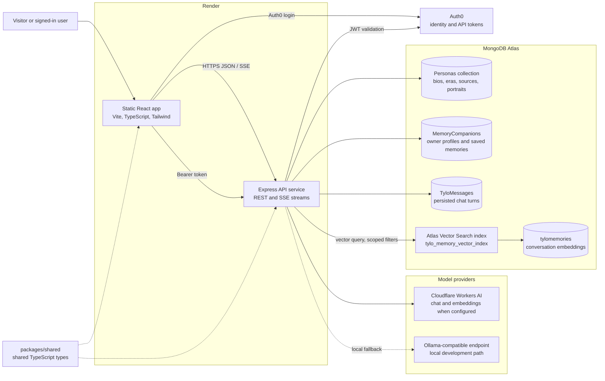
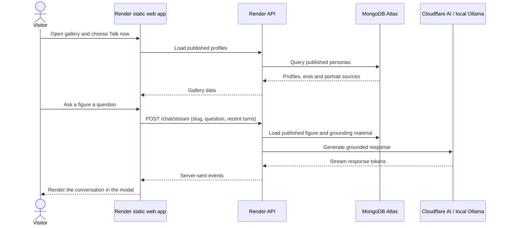
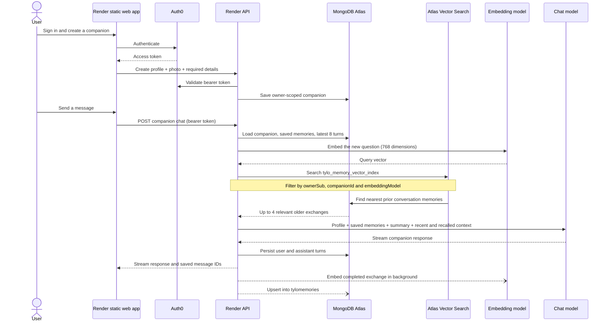

# People of the Past

> History is more than a list of dates. It is people, choices, voices and the memories we carry forward.

**People of the Past (POT)** is a historical archive with two ways into the past. **Ghost Gallery** makes the lives and ideas of historical figures explorable through biographies and grounded conversations. **TYLO** gives people a private place to preserve stories about loved ones and talk with an AI companion shaped by the details they choose to share.

POT is designed as a candlelit archive: midnight and plum surfaces, pumpkin and amber light, parchment typography, antique portrait frames, and portraits that shift from monochrome to colour on hover or keyboard focus. The experience aims to feel reflective and personal, not like a generic chat dashboard.

## The two experiences

### Ghost Gallery — meet the people behind the history

The main archive contains 50 historical profiles, with country filtering and individual biographies. A separate **Recent Legacies** section highlights five recently deceased public figures; it stays separate from the historical archive and its count.

Visitors can open a story or start a streamed conversation from **Talk now**. Conversations use each figure’s biography and profile as grounding context. Portraits carry source and credit information where available. Ancient figures may have historical artistic depictions rather than photographs, and those depictions should be identified honestly.

### TYLO — keep the stories close

TYLO is a private memory companion for someone the user has lost. The user creates a profile with a photo, introduction and 15 required details about the person’s life, relationship, personality, routines, stories, values, phrases and dates. They can add saved memories and continue a persisted conversation.

TYLO combines the latest conversation turns with saved profile information, saved memories, a factual summary of user-shared details, and semantically relevant older exchanges. The goal is to make the conversation more personal through information the user has chosen to provide, while keeping each companion and its records scoped to its owner.

## Architecture



The frontend and API are separate Render services. The API validates Auth0 tokens for protected TYLO routes and uses the token subject as the ownership boundary in MongoDB queries. Ghost Gallery reads published profile data. TYLO writes and reads the signed-in user’s companions, memories and messages.

### Ghost Gallery conversation flow



### TYLO memory and retrieval flow



### TYLO semantic memory in Atlas

Each completed exchange can be stored in the `tylomemories` collection with its text, a 768-number embedding, the embedding model name, timestamp, and owner/companion identifiers. For a new question, the API embeds the query and runs Atlas `$vectorSearch` against the `embedding` field. It requests up to four nearby exchanges and filters the search by `ownerSub`, `companionId`, and `embeddingModel`, so memories are retrieved for the correct user and companion and only compared with vectors made by the active model.

The configured Atlas Search index name is **`tylo_memory_vector_index`**. Create a Vector Search index on the `tylomemories` collection with this mapping:

```json
{
  "fields": [
    {
      "type": "vector",
      "path": "embedding",
      "numDimensions": 768,
      "similarity": "cosine"
    },
    { "type": "filter", "path": "ownerSub" },
    { "type": "filter", "path": "companionId" },
    { "type": "filter", "path": "embeddingModel" }
  ]
}
```

The vector service uses Cloudflare’s configured embedding model when Cloudflare credentials are present. Local development uses the Ollama-compatible `embeddinggemma-2:270m` model. Both paths are expected to return 768-dimensional vectors. When changing embedding models, existing vectors may need the provided backfill script so old exchanges can be retrieved with the active model.

## Technology

| Layer | Technology |
| --- | --- |
| Frontend | React, TypeScript, Vite, Tailwind CSS 4, React Router |
| API | Node.js, Express, TypeScript, Zod |
| Shared contracts | `packages/shared` TypeScript types and schemas |
| Identity | Auth0 React SDK and API bearer-token validation |
| Primary data | MongoDB Atlas with Mongoose |
| Semantic retrieval | MongoDB Atlas Vector Search and 768-dimensional embeddings |
| Chat and embeddings | Cloudflare Workers AI when configured; Ollama-compatible local model path for development |
| Hosting | Render static web service and API web service, configured in `render.yaml` |

## Repository structure

```text
apps/
  api/       Express API: routes, controllers, models, services and scripts
  web/       React app: pages, feature components, hooks and API clients
packages/
  shared/    Shared types and validation schemas
render.yaml  Render web and API service definitions
```

## Run locally

### Requirements

- Node.js 24.x and npm.
- MongoDB Atlas cluster and a connection string allowed from your current IP.
- Auth0 application and API settings for signed-in TYLO routes.
- Cloudflare Workers AI credentials for the configured cloud path, or an Ollama-compatible local chat and embedding endpoint.

### Install and configure

From the repository root:

```powershell
npm install
Copy-Item .env.example apps/api/.env
Copy-Item apps/web/.env.example apps/web/.env
```

Fill the local files with your own values. **Never commit `.env` files or expose MongoDB or Cloudflare credentials.** The API loads `apps/api/.env`; the web app loads `apps/web/.env`.

API environment variables:

| Variable | Use |
| --- | --- |
| `MONGODB_URI` | MongoDB Atlas connection string |
| `PORT` | API port (default `4000`) |
| `WEB_ORIGIN` | Allowed frontend origin (default `http://localhost:5173`) |
| `AUTH0_DOMAIN` | Auth0 tenant domain, without protocol |
| `AUTH0_AUDIENCE` | API audience (default `https://api.pot.local`) |
| `MODEL_BASE_URL`, `MODEL_NAME` | Local Ollama-compatible chat endpoint and model |
| `CLOUDFLARE_ACCOUNT_ID`, `CLOUDFLARE_API_TOKEN` | Optional credentials for cloud chat and embeddings |
| `CLOUDFLARE_CHAT_MODEL`, `CLOUDFLARE_EMBEDDING_MODEL` | Optional Cloudflare model names |

Frontend environment variables:

| Variable | Use |
| --- | --- |
| `VITE_AUTH0_DOMAIN` | Auth0 tenant domain |
| `VITE_AUTH0_CLIENT_ID` | Auth0 application client ID |
| `VITE_AUTH0_AUDIENCE` | Auth0 API audience |
| `VITE_API_BASE_URL` | API base URL, e.g. `http://localhost:4000/api/v1` |

### Start the app

```powershell
npm run dev
```

Or start each workspace in its own terminal:

```powershell
npm run dev:api
npm run dev:web
```

- Web app: `http://localhost:5173`
- API health: `http://localhost:4000/api/v1/health`

The API startup waits for MongoDB Atlas. If connection selection fails, check the Atlas IP access list and connection string locally; do not paste credentials into logs or chat.

## API routes

All routes use the `/api/v1` prefix.

| Method | Route | Access | Purpose |
| --- | --- | --- | --- |
| `GET` | `/health` | Public | Health check |
| `GET` | `/auth/me` | Auth0 bearer token | Validate identity and return the user subject |
| `GET` | `/personas` | Public | List published personas; supports archive filters |
| `GET` | `/personas/:slug` | Public | Fetch a published persona |
| `GET` | `/personas/:slug/details` | Public | Fetch biography and story details |
| `POST` | `/chat` | Public | Non-streaming historical chat |
| `POST` | `/chat/stream` | Public | Stream historical chat response |
| `GET` | `/tylo/companions` | Auth0 bearer token | List the owner’s companions |
| `POST` | `/tylo/companions` | Auth0 bearer token | Create a companion |
| `GET` | `/tylo/companions/:id` | Auth0 bearer token | Read an owned companion |
| `PATCH` | `/tylo/companions/:id` | Auth0 bearer token | Update an owned companion |
| `DELETE` | `/tylo/companions/:id` | Auth0 bearer token | Delete companion and associated records |
| `POST` | `/tylo/companions/:id/memories` | Auth0 bearer token | Add a saved memory |
| `GET` | `/tylo/companions/:id/messages` | Auth0 bearer token | Load persisted conversation |
| `POST` | `/tylo/companions/:id/chat` | Auth0 bearer token | Stream a TYLO response and persist the exchange |

## Commands

```powershell
npm run dev
npm run build
npm run typecheck
npm run build --workspace=apps/api
npm run build --workspace=apps/web
```

API maintenance scripts are available for seeding archive profiles, refreshing portraits, repairing TYLO summaries, and backfilling vector memories. Read a script before running it against a database with data you care about.

## Privacy and operating notes

- Authenticated TYLO reads and writes are scoped to the Auth0 subject and companion ID.
- TYLO profile data, saved memories, and persisted messages live in MongoDB Atlas.
- Profile photos are currently compressed in the browser and stored as data URLs in companion documents. This is simple to operate, but increases document and list-response size as users add companions; moving photos to dedicated object storage is a future scaling option.
- Semantic indexing runs after the user-visible reply so it does not hold up the response. If embedding/indexing fails, the service logs the failure; recent history and profile context remain the immediate chat context.
- A portrait URL responding with an image does not prove that the image shows the intended person or that its license is suitable. Keep identity, depiction type, source and credit under review.

## Render deployment

`render.yaml` defines two services: a static React frontend and a Node API web service. The frontend rewrite serves `index.html` for client-side routes. The API service uses `/api/v1/health` as its health check and connects to MongoDB Atlas.

Configure secrets and public values in each Render service’s environment settings. Keep `MONGODB_URI`, Auth0 server configuration, and Cloudflare API credentials on the API service only. Set the frontend’s `VITE_API_BASE_URL` to the deployed API base URL and its Auth0 domain, client ID and audience to the configured public client values.
