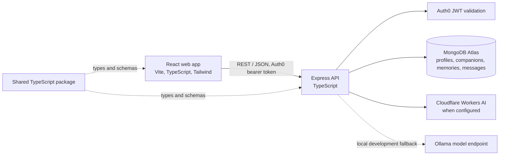
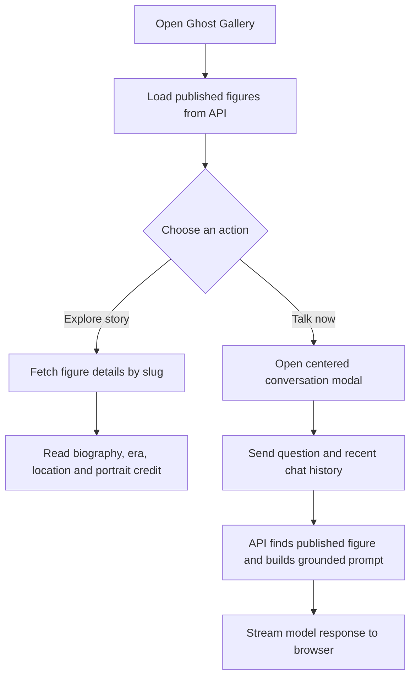
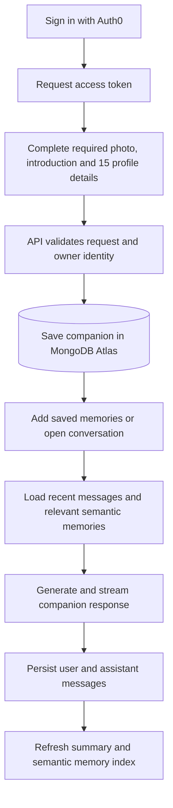

# People of the Past (POT)

People of the Past is a candlelit historical archive and conversational experience. **Ghost Gallery** lets people explore the lives and ideas of historical figures and ask them questions grounded in their biographies. **TYLO** helps people preserve memories of loved ones in a private, personal AI companion.

The visual identity is a haunted historical archive: midnight and plum surfaces, pumpkin and candlelight accents, parchment text, antique portrait frames, and portraits that move from monochrome to colour on hover or keyboard focus.

## Features

### Ghost Gallery

- Browse a main archive of 50 historical figures, with country filtering.
- Browse five recently deceased people in a separate **Recent Legacies** section.
- Open a figure’s biography and source information.
- Start a streamed conversation from **Talk now** on a gallery card.
- Use portraits with source and credit information where available. Some historical figures are represented by artistic depictions rather than photographs.

### TYLO

- Create a private companion profile with a photo, introduction, and 15 required profile details.
- Add saved memories and continue a persisted conversation.
- Retrieve relevant older conversation memories semantically to provide context.
- Keep companions and conversations scoped to the authenticated owner.
- Delete a companion and its associated memory and conversation data.

## Workflows

### Application architecture



### Explore and talk to a historical figure



### Create a TYLO companion and chat



## Technology

| Area | Technology |
| --- | --- |
| Web | React, TypeScript, Vite, Tailwind CSS 4, React Router |
| API | Node.js, Express, TypeScript, Zod |
| Database | MongoDB Atlas with Mongoose |
| Authentication | Auth0 React SDK and Express JWT validation |
| AI | Cloudflare Workers AI when configured; Ollama-compatible local endpoint for development |
| Monorepo | npm workspaces; `packages/shared` for shared types and schemas |
| Hosting | Render configuration in `render.yaml` |

## Repository layout

```text
apps/
  api/       Express routes, controllers, services, models and scripts
  web/       React pages, features, components and API clients
packages/
  shared/    Types and validation shared between web and API
render.yaml  Render service configuration
```

The web app is grouped by features under `apps/web/src/features/ghost-gallery` and `apps/web/src/features/tylo`. API code is split into routes, controllers, services, models, middleware, config and scripts under `apps/api/src`.

## Getting started

### Requirements

- Node.js 24.x and npm.
- An accessible MongoDB Atlas cluster.
- Auth0 application and API configuration for protected TYLO routes.
- Either Cloudflare Workers AI credentials or an Ollama-compatible local model endpoint for AI responses.

### Install dependencies

From the repository root:

```powershell
npm install
```

### Configure environment

The API loads its environment from `apps/api/.env` when started through its workspace script. The web app loads `apps/web/.env`.

```powershell
Copy-Item .env.example apps/api/.env
Copy-Item apps/web/.env.example apps/web/.env
```

Set the values in those local files. Do not commit `.env` files or paste secrets into issues or chat.

**API settings** in `apps/api/.env`:

| Variable | Purpose |
| --- | --- |
| `MONGODB_URI` | MongoDB Atlas connection string |
| `PORT` | API port; defaults to `4000` |
| `WEB_ORIGIN` | Allowed web origin for CORS; defaults to `http://localhost:5173` |
| `AUTH0_DOMAIN` | Auth0 tenant domain, without `https://` |
| `AUTH0_AUDIENCE` | Auth0 API audience; defaults to `https://api.pot.local` |
| `MODEL_BASE_URL`, `MODEL_NAME` | Local Ollama-compatible model endpoint and model |
| `CLOUDFLARE_ACCOUNT_ID`, `CLOUDFLARE_API_TOKEN` | Optional Cloudflare Workers AI credentials |
| `CLOUDFLARE_CHAT_MODEL`, `CLOUDFLARE_EMBEDDING_MODEL` | Optional Cloudflare chat and embedding models |

Cloudflare credentials are optional when using the local model path. The backend uses Cloudflare AI when both account ID and API token are configured.

**Web settings** in `apps/web/.env`:

| Variable | Purpose |
| --- | --- |
| `VITE_AUTH0_DOMAIN` | Auth0 tenant domain |
| `VITE_AUTH0_CLIENT_ID` | Auth0 application client ID |
| `VITE_AUTH0_AUDIENCE` | Auth0 API audience |
| `VITE_API_BASE_URL` | API base URL, e.g. `http://localhost:4000/api/v1` |

Only public client configuration belongs in web environment variables. Never put the MongoDB URI or Cloudflare API token in `apps/web/.env`.

### Run locally

Run the API and web app together:

```powershell
npm run dev
```

Or run them in separate terminals:

```powershell
npm run dev:api
npm run dev:web
```

The default local addresses are:

- Web: `http://localhost:5173`
- API health: `http://localhost:4000/api/v1/health`

The API must be able to reach MongoDB Atlas. If startup reports a MongoDB server-selection or allow-list error, check Atlas Network Access for the current development IP and verify the local `MONGODB_URI` without sharing it.

## API overview

All endpoints are prefixed with `/api/v1`.

| Method | Endpoint | Authentication | Purpose |
| --- | --- | --- | --- |
| `GET` | `/health` | Public | API health check |
| `GET` | `/auth/me` | Auth0 bearer token | Return the authenticated user identity |
| `GET` | `/personas` | Public | List/filter published historical figures |
| `GET` | `/personas/:slug` | Public | Get a published figure |
| `GET` | `/personas/:slug/details` | Public | Get a figure biography and details |
| `POST` | `/chat` | Public | Non-streaming historical conversation |
| `POST` | `/chat/stream` | Public | Stream historical conversation response |
| `GET` | `/tylo/companions` | Auth0 bearer token | List the current user’s companions |
| `POST` | `/tylo/companions` | Auth0 bearer token | Create a companion |
| `GET` | `/tylo/companions/:id` | Auth0 bearer token | Get an owned companion |
| `PATCH` | `/tylo/companions/:id` | Auth0 bearer token | Update an owned companion |
| `DELETE` | `/tylo/companions/:id` | Auth0 bearer token | Delete an owned companion and related data |
| `POST` | `/tylo/companions/:id/memories` | Auth0 bearer token | Save a memory |
| `GET` | `/tylo/companions/:id/messages` | Auth0 bearer token | Load persisted conversation messages |
| `POST` | `/tylo/companions/:id/chat` | Auth0 bearer token | Send a TYLO message and persist the response |

## Useful commands

```powershell
npm run build
npm run typecheck
npm run build --workspace=apps/api
npm run build --workspace=apps/web
```

The API package also provides scripts for seeding profiles and maintaining portraits, TYLO summaries and vector memories. Review each script before running it against a database with important data.

## Data and privacy notes

- TYLO endpoints validate the Auth0 subject and scope database reads/writes to that owner.
- Companion profiles, memories and persisted messages are stored in MongoDB Atlas.
- Current profile photo uploads are compressed in the browser and stored as data URLs on the companion document. This keeps storage simple for the current implementation but adds image bytes to companion API responses; a dedicated image store could reduce payload size as usage grows.
- Portrait sources and credits are kept with historical profile records where available. An image URL check confirms that a URL serves an image; it does not establish the identity or licensing of the person depicted, so portrait attribution should be reviewed carefully.

## Deployment

`render.yaml` defines an API web service and a static web service. Configure the API’s private environment values in Render’s service settings and set the web service’s public Auth0 and API URL values there. The frontend rewrite sends browser routes to `index.html` so React Router can handle direct navigation.
